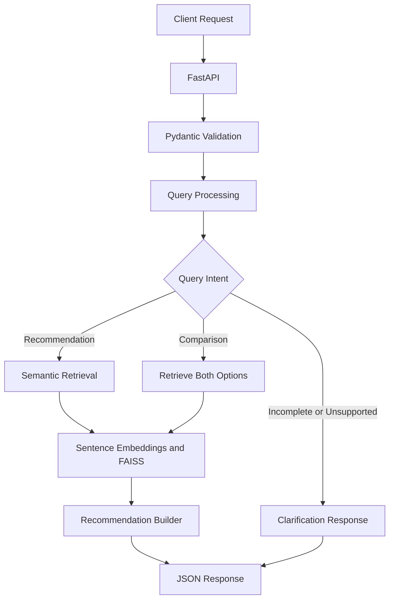

# Assess1Q
### Intelligent Assessment Discovery & Recommendation API

Assess1Q is an AI-powered assessment discovery system that helps users identify relevant assessments based on hiring requirements expressed in natural language. It combines semantic retrieval, vector search, and rule-based conversational logic to return relevant recommendations, handle clarification requests, and compare assessment options through a REST API.

## Key Features

- **Semantic Retrieval:** Uses Sentence Transformers embeddings and FAISS to search for relevant assessments.
- **Conversational Query Handling:** Processes user messages and asks for missing role or seniority details.
- **Assessment Comparison:** Retrieves and compares assessment options based on user queries.
- **Explainable Recommendations:** Returns assessment details with reasons for their relevance.
- **REST API:** Exposes recommendation functionality through FastAPI endpoints.
- **Input Validation:** Uses Pydantic models to validate incoming chat requests.

## Tech Stack

`Python` · `FastAPI` · `Sentence Transformers` · `FAISS` · `Pydantic` · `Render`

**Embedding model:** `all-MiniLM-L6-v2`

## System Architecture



## API Endpoints

| Method | Endpoint | Purpose |
|---|---|---|
| `GET` | `/health` | Checks API availability |
| `POST` | `/chat` | Processes messages and returns recommendations |

### Example Request

```json
{
  "messages": [
    {
      "role": "user",
      "content": "Recommend assessments for an entry-level Python developer"
    }
  ]
}
```

The API returns a JSON response containing a conversational reply, relevant recommendations, and supporting details when available.

## Run Locally

```bash
git clone https://github.com/ar7205/intelligent-assessment-recommendation-api.git
cd intelligent-assessment-recommendation-api
pip install -r requirements.txt
uvicorn app:app --reload
```

Once running, explore the interactive API documentation at `http://127.0.0.1:8000/docs`.

## Future Improvements

- Automated API and retrieval evaluation tests
- Improved query intent classification and comparison parsing
- Retrieval quality evaluation using a labeled test dataset
- Conversation state management and structured logging

## Project Scope

Assess1Q demonstrates semantic search, vector retrieval, API development, and rule-based conversational workflows in an assessment discovery use case.

Third-party datasets and materials should only be used or redistributed where authorized.
